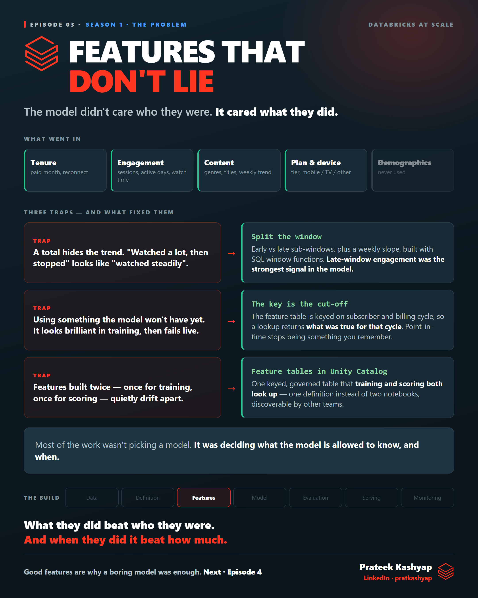

# Episode 03 · Features that don't lie

**Season 1 · The Problem**

The model didn't care who subscribers were — it cared what they did. This episode covers the three traps in feature building: a total that hides the trend, using data the model won't have yet, and features built twice that drift apart.

| File | What it is |
|---|---|
| [`ep03-learn.md`](ep03-learn.md) | **The full breakdown** — start here |
| [`ep03-post.md`](ep03-post.md) | The LinkedIn post — the short version |
| [`ep03-poster.png`](ep03-poster.png) | The visual |
| [`ep03-cert-prep.md`](ep03-cert-prep.md) | Short recall questions |

**Databricks in this episode:** **Feature Engineering in Unity Catalog** · feature tables and keys · feature lookups · SQL window functions · point-in-time correctness · leakage · training/serving skew · online lookup *(next)*

← [Episode 02](../02-where-the-data-lives/) · [Episode 04](../04-why-the-boring-model-won/) →
