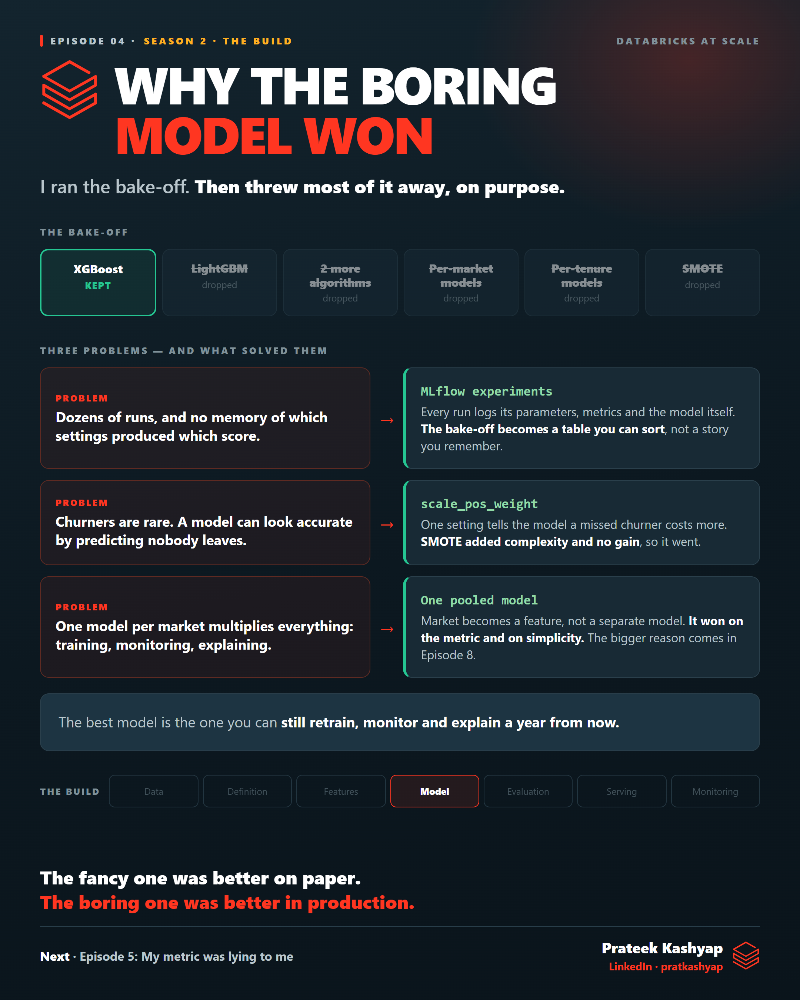

# Episode 04 · Why the boring model won

**Season 2 · The Build**

I ran the bake-off — four algorithms, per-market models, per-tenure models, resampling — then threw most of it away. This episode covers MLflow experiments as the record of a bake-off, why class weighting beat SMOTE, and why one pooled model beat one model per market.

| File | What it is |
|---|---|
| [`ep04-learn.md`](ep04-learn.md) | **The full breakdown** — start here |
| [`ep04-post.md`](ep04-post.md) | The LinkedIn post — the short version |
| [`ep04-poster.png`](ep04-poster.png) | The visual |
| [`ep04-cert-prep.md`](ep04-cert-prep.md) | Short recall questions |

**Databricks in this episode:** MLflow experiments · runs, parameters, metrics and artifacts · `mlflow.xgboost.log_model` · class imbalance · `scale_pos_weight` · PR AUC as the training metric · locked hyperparameters · AutoML *(next)*

← [Episode 03](../03-features-that-dont-lie/) · [Episode 05](../05-my-metric-was-lying/) →
