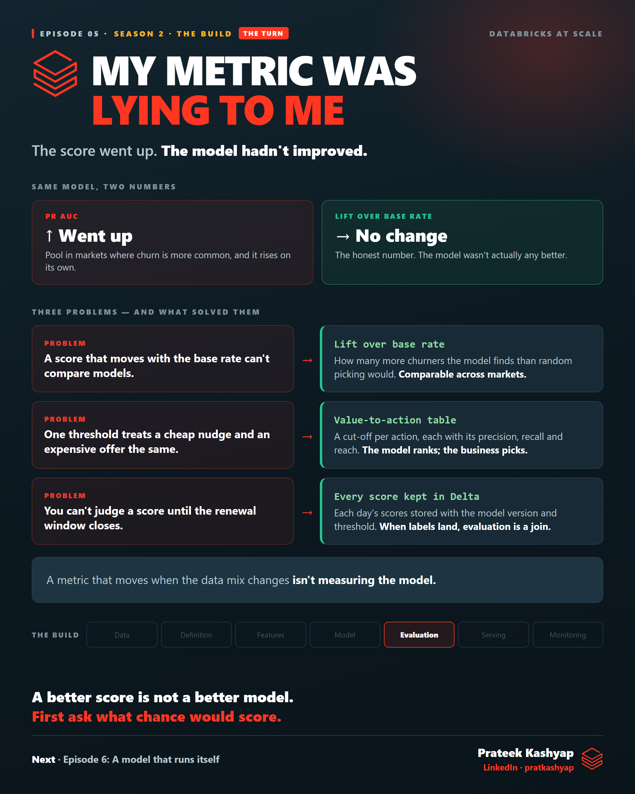

# Episode 05 · My metric was lying to me ⭐

**Season 2 · The Build** — *the turn*

The score went up; the model hadn't improved. This episode covers why PR AUC rises with the base rate, why lift over base rate is the honest comparison, the value-to-action table that replaces a single threshold, and keeping every score in Delta so late-arriving labels can grade it.

| File | What it is |
|---|---|
| [`ep05-learn.md`](ep05-learn.md) | **The full breakdown** — start here |
| [`ep05-post.md`](ep05-post.md) | The LinkedIn post — the short version |
| [`ep05-poster.png`](ep05-poster.png) | The visual |
| [`ep05-cert-prep.md`](ep05-cert-prep.md) | Short recall questions |

**Databricks in this episode:** evaluation with late-arriving labels · predictions table in Delta · lift over base rate in SQL · precision, recall and thresholds · value-to-action table · MLflow evaluation *(next)*

← [Episode 04](../04-why-the-boring-model-won/) · [Episode 06](../06-runs-itself/) →
