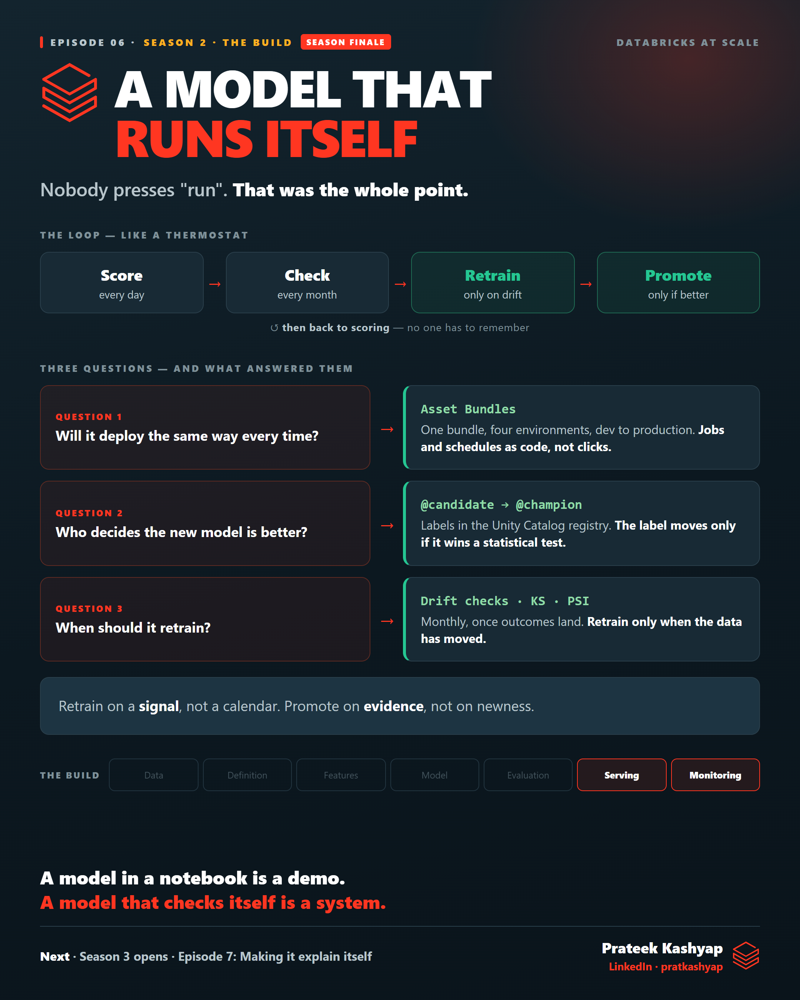

# Episode 06 · A model that runs itself

**Season 2 · The Build** — *season finale*

Nobody presses "run". This episode covers deploying every job from one Asset Bundle with four targets, promoting models by moving `@champion` and `@candidate` aliases behind a statistical gate, and retraining only when monthly drift checks say so.

| File | What it is |
|---|---|
| [`ep06-learn.md`](ep06-learn.md) | **The full breakdown** — start here |
| [`ep06-post.md`](ep06-post.md) | The LinkedIn post — the short version |
| [`ep06-poster.png`](ep06-poster.png) | The visual |
| [`ep06-cert-prep.md`](ep06-cert-prep.md) | Short recall questions |

**Databricks in this episode:** Asset Bundles · targets and variables · Workflows jobs and job clusters · Unity Catalog model registry · `@champion` / `@candidate` aliases · promotion gate · KS and PSI drift · batch scoring vs serving endpoints · Lakehouse Monitoring *(next)*

← [Episode 05](../05-my-metric-was-lying/) · [Episode 07](../07-making-it-explain-itself/) →
